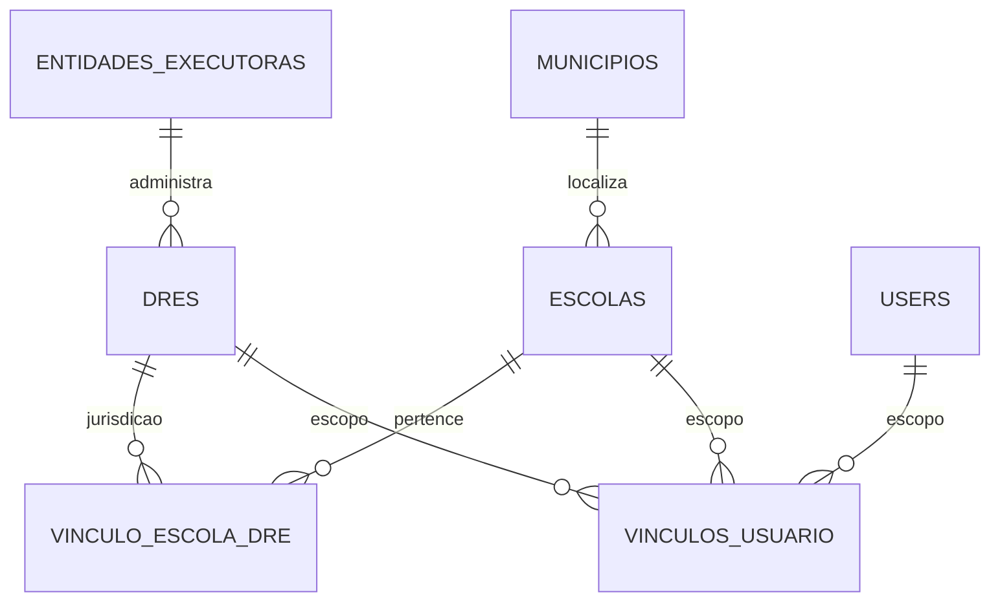
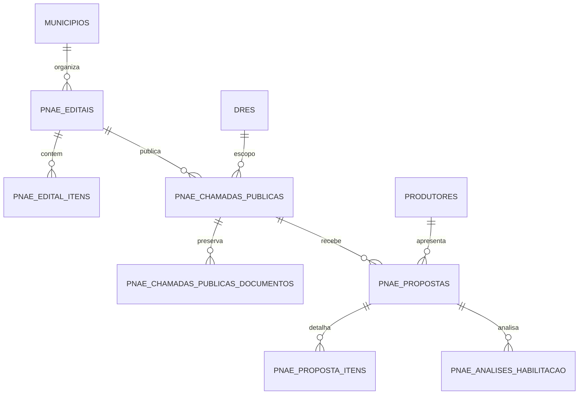
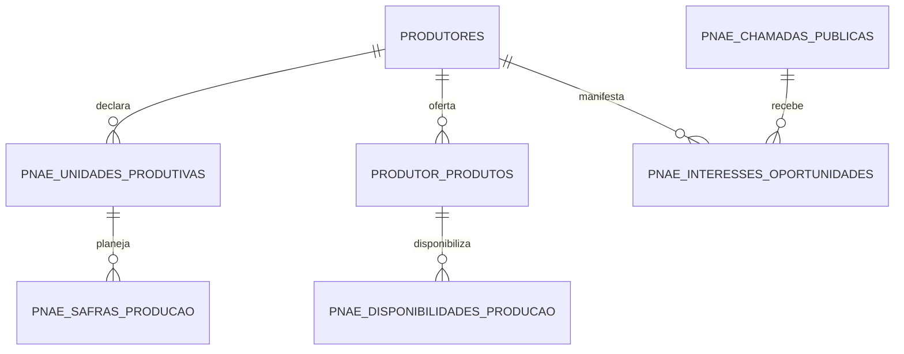
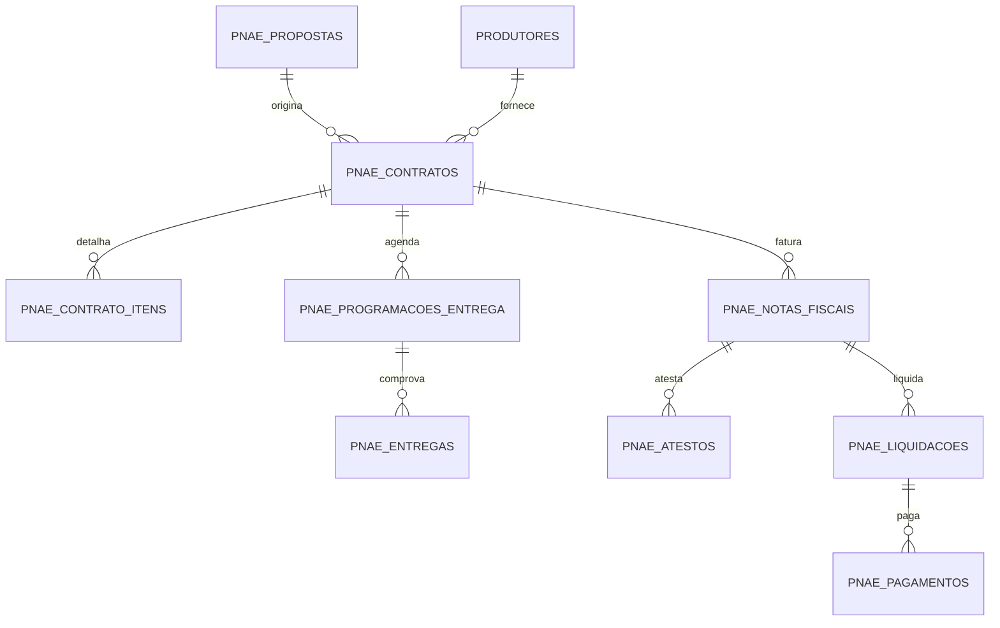

# Mapa de relacionamentos

Metadados extraidos de `information_schema.KEY_COLUMN_USAGE` (169 restricoes FK; sem FK composta) e traduzidos para os nomes-alvo da migration. Nenhuma FK foi criada ou removida nesta mudanca.

## Territorio e acesso

## Editais, chamadas e selecao

## Oferta do produtor

## Contratos, entrega e fiscal

## Todas as chaves estrangeiras

| Tabela filha | Coluna | Tabela referenciada | Coluna | Restricao atual |
|---|---|---|---|---|
| `dres` | `entidadeExecutoraId` | `entidades_executoras` | `id` | `dres_entidadeExecutoraId_fkey` |
| `entidades_executoras` | `municipioId` | `municipios` | `id` | `entidades_executoras_municipioId_fkey` |
| `escolas` | `municipioId` | `municipios` | `id` | `escolas_municipioId_fkey` |
| `pnae_analises_habilitacao` | `propostaId` | `pnae_propostas` | `id` | `pnae_analises_habilitacao_propostaId_fkey` |
| `pnae_atestos` | `atestoAnteriorId` | `pnae_atestos` | `id` | `pnae_atestos_atestoAnteriorId_fkey` |
| `pnae_atestos` | `contratoId` | `pnae_contratos` | `id` | `pnae_atestos_contratoId_fkey` |
| `pnae_atestos` | `notaFiscalId` | `pnae_notas_fiscais` | `id` | `pnae_atestos_notaFiscalId_fkey` |
| `pnae_campos_template` | `templateId` | `pnae_templates_documento` | `id` | `pnae_campos_template_templateId_fkey` |
| `pnae_chamadas_publicas` | `dreId` | `dres` | `id` | `pnae_chamadas_publicas_dreId_fkey` |
| `pnae_chamadas_publicas` | `editalId` | `pnae_editais` | `id` | `pnae_chamadas_publicas_editalId_fkey` |
| `pnae_chamadas_publicas` | `entidadeExecutoraId` | `entidades_executoras` | `id` | `pnae_chamadas_publicas_entidadeExecutoraId_fkey` |
| `pnae_chamadas_publicas` | `municipioId` | `municipios` | `id` | `pnae_chamadas_publicas_municipioId_fkey` |
| `pnae_chamadas_publicas_documentos` | `chamadaId` | `pnae_chamadas_publicas` | `id` | `pnae_chamadas_publicas_documentos_chamadaId_fkey` |
| `pnae_chamadas_publicas_escolas` | `chamadaId` | `pnae_chamadas_publicas` | `id` | `pnae_chamadas_publicas_escolas_chamadaId_fkey` |
| `pnae_chamadas_publicas_escolas` | `escolaId` | `escolas` | `id` | `pnae_chamadas_publicas_escolas_escolaId_fkey` |
| `pnae_checklists_implantacao` | `dreId` | `dres` | `id` | `checklist_dre_fk` |
| `pnae_checklists_implantacao` | `escolaId` | `escolas` | `id` | `checklist_escola_fk` |
| `pnae_checklists_implantacao` | `municipioId` | `municipios` | `id` | `checklist_municipio_fk` |
| `pnae_checklists_implantacao` | `responsavelId` | `users` | `id` | `checklist_user_fk` |
| `pnae_classificacoes_projetos` | `editalItemId` | `pnae_edital_itens` | `id` | `pnae_classificacoes_projetos_editalItemId_fkey` |
| `pnae_classificacoes_projetos` | `propostaId` | `pnae_propostas` | `id` | `pnae_classificacoes_projetos_propostaId_fkey` |
| `pnae_conferencias_fiscais` | `notaFiscalId` | `pnae_notas_fiscais` | `id` | `pnae_conferencias_fiscais_notaFiscalId_fkey` |
| `pnae_configuracoes_institucionais` | `dreId` | `dres` | `id` | `config_dre_fk` |
| `pnae_configuracoes_institucionais` | `escolaId` | `escolas` | `id` | `config_escola_fk` |
| `pnae_configuracoes_institucionais` | `municipioId` | `municipios` | `id` | `config_municipio_fk` |
| `pnae_configuracoes_institucionais` | `responsavelId` | `users` | `id` | `config_responsavel_fk` |
| `pnae_configuracoes_institucionais_historico` | `configuracaoId` | `pnae_configuracoes_institucionais` | `id` | `config_historico_config_fk` |
| `pnae_configuracoes_institucionais_historico` | `responsavelId` | `users` | `id` | `config_historico_user_fk` |
| `pnae_contratos` | `dreId` | `dres` | `id` | `pnae_contratos_dreId_fkey` |
| `pnae_contratos` | `editalId` | `pnae_editais` | `id` | `pnae_contratos_editalId_fkey` |
| `pnae_contratos` | `escolaId` | `escolas` | `id` | `pnae_contratos_escolaId_fkey` |
| `pnae_contratos` | `municipioId` | `municipios` | `id` | `pnae_contratos_municipioId_fkey` |
| `pnae_contratos` | `produtorId` | `produtores` | `id` | `pnae_contratos_produtorId_fkey` |
| `pnae_contratos` | `propostaId` | `pnae_propostas` | `id` | `pnae_contratos_propostaId_fkey` |
| `pnae_contrato_aditivos` | `contratoId` | `pnae_contratos` | `id` | `pnae_contrato_aditivos_contratoId_fkey` |
| `pnae_contrato_aditivo_itens` | `aditivoId` | `pnae_contrato_aditivos` | `id` | `pnae_contrato_aditivo_itens_aditivoId_fkey` |
| `pnae_contrato_aditivo_itens` | `contratoItemId` | `pnae_contrato_itens` | `id` | `pnae_contrato_aditivo_itens_item_fkey` |
| `pnae_contrato_documentos` | `aditivoId` | `pnae_contrato_aditivos` | `id` | `pnae_contrato_documentos_aditivoId_fkey` |
| `pnae_contrato_documentos` | `contratoId` | `pnae_contratos` | `id` | `pnae_contrato_documentos_contratoId_fkey` |
| `pnae_contrato_itens` | `contratoId` | `pnae_contratos` | `id` | `pnae_contrato_itens_contratoId_fkey` |
| `pnae_contrato_itens` | `editalItemId` | `pnae_edital_itens` | `id` | `pnae_contrato_itens_editalItemId_fkey` |
| `pnae_contrato_itens` | `propostaItemId` | `pnae_proposta_itens` | `id` | `pnae_contrato_itens_propostaItemId_fkey` |
| `pnae_contrato_signatarios` | `aditivoId` | `pnae_contrato_aditivos` | `id` | `pnae_contrato_signatarios_aditivoId_fkey` |
| `pnae_contrato_signatarios` | `contratoId` | `pnae_contratos` | `id` | `pnae_contrato_signatarios_contratoId_fkey` |
| `pnae_divergencias_fiscais` | `notaFiscalId` | `pnae_notas_fiscais` | `id` | `pnae_divergencias_fiscais_notaFiscalId_fkey` |
| `pnae_divergencias_fiscais` | `notaFiscalItemId` | `pnae_nota_fiscal_itens` | `id` | `pnae_divergencias_fiscais_notaFiscalItemId_fkey` |
| `pnae_editais` | `escolaId` | `escolas` | `id` | `pnae_editais_escolaId_fkey` |
| `pnae_editais` | `municipioId` | `municipios` | `id` | `pnae_editais_municipioId_fkey` |
| `pnae_edital_anexos` | `documentoId` | `pnae_edital_documentos` | `id` | `pnae_edital_anexos_documentoId_fkey` |
| `pnae_edital_anexos` | `templateId` | `pnae_templates_documento` | `id` | `pnae_edital_anexos_templateId_fkey` |
| `pnae_edital_anexos` | `templateVersaoId` | `pnae_template_versoes` | `id` | `pnae_edital_anexos_templateVersaoId_fkey` |
| `pnae_edital_documentos` | `editalId` | `pnae_editais` | `id` | `pnae_edital_documentos_editalId_fkey` |
| `pnae_edital_escolas` | `editalId` | `pnae_editais` | `id` | `pnae_edital_escolas_editalId_fkey` |
| `pnae_edital_escolas` | `escolaId` | `escolas` | `id` | `pnae_edital_escolas_escolaId_fkey` |
| `pnae_edital_itens` | `editalId` | `pnae_editais` | `id` | `pnae_edital_itens_editalId_fkey` |
| `pnae_edital_itens` | `produtoReferenciaId` | `pnae_produtos_referencia` | `id` | `pnae_edital_itens_produtoReferenciaId_fkey` |
| `pnae_edital_variaveis` | `documentoId` | `pnae_edital_documentos` | `id` | `pnae_edital_variaveis_documentoId_fkey` |
| `pnae_edital_versoes` | `documentoId` | `pnae_edital_documentos` | `id` | `pnae_edital_versoes_documentoId_fkey` |
| `pnae_entregas` | `dreId` | `dres` | `id` | `pnae_entregas_dreId_fkey` |
| `pnae_entregas` | `fornecedorId` | `produtores` | `id` | `pnae_entregas_fornecedorId_fkey` |
| `pnae_entregas` | `municipioId` | `municipios` | `id` | `pnae_entregas_municipioId_fkey` |
| `pnae_entregas` | `programacaoId` | `pnae_programacoes_entrega` | `id` | `pnae_entregas_programacaoId_fkey` |
| `pnae_entregas` | `unidadeEscolarId` | `escolas` | `id` | `pnae_entregas_unidadeEscolarId_fkey` |
| `pnae_entrega_documentos` | `entregaId` | `pnae_entregas` | `id` | `pnae_entrega_documentos_entregaId_fkey` |
| `pnae_entrega_estornos` | `entregaId` | `pnae_entregas` | `id` | `pnae_entrega_estornos_entregaId_fkey` |
| `pnae_entrega_itens` | `entregaId` | `pnae_entregas` | `id` | `pnae_entrega_itens_entregaId_fkey` |
| `pnae_entrega_itens` | `programacaoItemId` | `pnae_programacao_entrega_itens` | `id` | `pnae_entrega_itens_programacaoItemId_fkey` |
| `pnae_habilitacao_documentos` | `propostaId` | `pnae_propostas` | `id` | `pnae_habilitacao_documentos_propostaId_fkey` |
| `pnae_habilitacao_documentos` | `requisitoId` | `pnae_requisitos_habilitacao` | `id` | `pnae_habilitacao_documentos_requisitoId_fkey` |
| `pnae_historico_geracao_documento` | `documentoId` | `pnae_edital_documentos` | `id` | `pnae_historico_geracao_documento_documentoId_fkey` |
| `pnae_historico_geracao_documento` | `versaoId` | `pnae_edital_versoes` | `id` | `pnae_historico_geracao_documento_versaoId_fkey` |
| `pnae_homologacoes_chamadas` | `chamadaId` | `pnae_chamadas_publicas` | `id` | `pnae_homologacoes_chamadas_chamadaId_fkey` |
| `pnae_importacao_campos` | `estruturaId` | `pnae_importacao_estruturas` | `id` | `pnae_importacao_campos_estruturaId_fkey` |
| `pnae_importacao_estruturas` | `importLogId` | `pnae_import_logs` | `id` | `pnae_importacao_estruturas_importLogId_fkey` |
| `pnae_import_logs` | `editalId` | `pnae_editais` | `id` | `pnae_import_logs_editalId_fkey` |
| `pnae_inscricoes_chamadas` | `chamadaId` | `pnae_chamadas_publicas` | `id` | `pnae_inscricoes_chamadas_chamadaId_fkey` |
| `pnae_inscricoes_chamadas` | `produtorId` | `produtores` | `id` | `pnae_inscricoes_chamadas_produtorId_fkey` |
| `pnae_itens_checklist_implantacao` | `checklistId` | `pnae_checklists_implantacao` | `id` | `checklist_item_checklist_fk` |
| `pnae_itens_checklist_implantacao` | `responsavelId` | `users` | `id` | `checklist_item_user_fk` |
| `pnae_liquidacoes` | `contratoId` | `pnae_contratos` | `id` | `pnae_liquidacoes_contratoId_fkey` |
| `pnae_liquidacoes` | `notaFiscalId` | `pnae_notas_fiscais` | `id` | `pnae_liquidacoes_notaFiscalId_fkey` |
| `pnae_matches` | `editalId` | `pnae_editais` | `id` | `pnae_matches_editalId_fkey` |
| `pnae_matches` | `editalItemId` | `pnae_edital_itens` | `id` | `pnae_matches_editalItemId_fkey` |
| `pnae_matches` | `escolaId` | `escolas` | `id` | `pnae_matches_escolaId_fkey` |
| `pnae_matches` | `produtoReferenciaId` | `pnae_produtos_referencia` | `id` | `pnae_matches_produtoReferenciaId_fkey` |
| `pnae_matches` | `produtorId` | `produtores` | `id` | `pnae_matches_produtorId_fkey` |
| `pnae_matches` | `produtorProdutoId` | `produtor_produtos` | `id` | `pnae_matches_produtorProdutoId_fkey` |
| `pnae_notas_fiscais` | `contratoId` | `pnae_contratos` | `id` | `pnae_notas_fiscais_contratoId_fkey` |
| `pnae_notas_fiscais` | `fornecedorId` | `produtores` | `id` | `pnae_notas_fiscais_fornecedorId_fkey` |
| `pnae_notas_fiscais` | `pdfDocumentoId` | `pnae_nota_fiscal_documentos` | `id` | `pnae_notas_fiscais_pdfDocumentoId_fkey` |
| `pnae_notas_fiscais` | `xmlDocumentoId` | `pnae_nota_fiscal_documentos` | `id` | `pnae_notas_fiscais_xmlDocumentoId_fkey` |
| `pnae_nota_fiscal_documentos` | `notaFiscalId` | `pnae_notas_fiscais` | `id` | `pnae_nota_fiscal_documentos_notaFiscalId_fkey` |
| `pnae_nota_fiscal_itens` | `contratoItemId` | `pnae_contrato_itens` | `id` | `pnae_nota_fiscal_itens_contratoItemId_fkey` |
| `pnae_nota_fiscal_itens` | `notaFiscalId` | `pnae_notas_fiscais` | `id` | `pnae_nota_fiscal_itens_notaFiscalId_fkey` |
| `pnae_notificacoes_internas` | `userId` | `users` | `id` | `notificacao_user_fk` |
| `pnae_ocorrencias_entrega` | `entregaId` | `pnae_entregas` | `id` | `pnae_ocorrencias_entrega_entregaId_fkey` |
| `pnae_ocorrencias_entrega` | `entregaItemId` | `pnae_entrega_itens` | `id` | `pnae_ocorrencias_entrega_entregaItemId_fkey` |
| `pnae_pagamentos` | `contratoId` | `pnae_contratos` | `id` | `pnae_pagamentos_contratoId_fkey` |
| `pnae_pagamentos` | `liquidacaoId` | `pnae_liquidacoes` | `id` | `pnae_pagamentos_liquidacaoId_fkey` |
| `pnae_pagamentos` | `notaFiscalId` | `pnae_notas_fiscais` | `id` | `pnae_pagamentos_notaFiscalId_fkey` |
| `pnae_parametros_operacionais` | `responsavelId` | `users` | `id` | `parametro_user_fk` |
| `pnae_parametros_operacionais_versoes` | `parametroId` | `pnae_parametros_operacionais` | `id` | `parametro_versao_parametro_fk` |
| `pnae_parametros_operacionais_versoes` | `responsavelId` | `users` | `id` | `parametro_versao_user_fk` |
| `pnae_prestacoes_contas` | `dreId` | `dres` | `id` | `pnae_prestacoes_contas_dreId_fkey` |
| `pnae_prestacoes_contas` | `escolaId` | `escolas` | `id` | `pnae_prestacoes_contas_escolaId_fkey` |
| `pnae_prestacoes_contas_documentos` | `prestacaoContasId` | `pnae_prestacoes_contas` | `id` | `pnae_prestacoes_contas_documentos_prestacaoContasId_fkey` |
| `pnae_programacao_entrega_itens` | `contratoItemId` | `pnae_contrato_itens` | `id` | `pnae_programacao_entrega_itens_contratoItemId_fkey` |
| `pnae_programacao_entrega_itens` | `programacaoId` | `pnae_programacoes_entrega` | `id` | `pnae_programacao_entrega_itens_programacaoId_fkey` |
| `pnae_programacoes_entrega` | `contratoId` | `pnae_contratos` | `id` | `pnae_programacoes_entrega_contratoId_fkey` |
| `pnae_programacoes_entrega` | `dreId` | `dres` | `id` | `pnae_programacoes_entrega_dreId_fkey` |
| `pnae_programacoes_entrega` | `fornecedorId` | `produtores` | `id` | `pnae_programacoes_entrega_fornecedorId_fkey` |
| `pnae_programacoes_entrega` | `municipioId` | `municipios` | `id` | `pnae_programacoes_entrega_municipioId_fkey` |
| `pnae_programacoes_entrega` | `unidadeEscolarId` | `escolas` | `id` | `pnae_programacoes_entrega_unidadeEscolarId_fkey` |
| `pnae_propostas` | `chamadaPublicaId` | `pnae_chamadas_publicas` | `id` | `pnae_propostas_chamadaPublicaId_fkey` |
| `pnae_propostas` | `editalId` | `pnae_editais` | `id` | `pnae_propostas_editalId_fkey` |
| `pnae_propostas` | `produtorId` | `produtores` | `id` | `pnae_propostas_produtorId_fkey` |
| `pnae_proposta_itens` | `matchId` | `pnae_matches` | `id` | `pnae_proposta_itens_matchId_fkey` |
| `pnae_proposta_itens` | `propostaId` | `pnae_propostas` | `id` | `pnae_proposta_itens_propostaId_fkey` |
| `pnae_recursos_chamadas` | `chamadaId` | `pnae_chamadas_publicas` | `id` | `pnae_recursos_chamadas_chamadaId_fkey` |
| `pnae_recursos_chamadas` | `produtorId` | `produtores` | `id` | `pnae_recursos_chamadas_produtorId_fkey` |
| `pnae_recursos_chamadas` | `propostaId` | `pnae_propostas` | `id` | `pnae_recursos_chamadas_propostaId_fkey` |
| `pnae_requisitos_habilitacao` | `chamadaId` | `pnae_chamadas_publicas` | `id` | `pnae_requisitos_habilitacao_chamadaId_fkey` |
| `pnae_resultados_chamadas` | `chamadaId` | `pnae_chamadas_publicas` | `id` | `pnae_resultados_chamadas_chamadaId_fkey` |
| `pnae_template_versoes` | `templateId` | `pnae_templates_documento` | `id` | `pnae_template_versoes_templateId_fkey` |
| `pnae_vinculo_recebimento_fiscal` | `contratoId` | `pnae_contratos` | `id` | `pnae_vinculo_recebimento_fiscal_contratoId_fkey` |
| `pnae_vinculo_recebimento_fiscal` | `contratoItemId` | `pnae_contrato_itens` | `id` | `pnae_vinculo_recebimento_fiscal_contratoItemId_fkey` |
| `pnae_vinculo_recebimento_fiscal` | `entregaId` | `pnae_entregas` | `id` | `pnae_vinculo_recebimento_fiscal_entregaId_fkey` |
| `pnae_vinculo_recebimento_fiscal` | `entregaItemId` | `pnae_entrega_itens` | `id` | `pnae_vinculo_recebimento_fiscal_entregaItemId_fkey` |
| `pnae_vinculo_recebimento_fiscal` | `notaFiscalId` | `pnae_notas_fiscais` | `id` | `pnae_vinculo_recebimento_fiscal_notaFiscalId_fkey` |
| `pnae_vinculo_recebimento_fiscal` | `notaFiscalItemId` | `pnae_nota_fiscal_itens` | `id` | `pnae_vinculo_recebimento_fiscal_notaFiscalItemId_fkey` |
| `produtores` | `municipioId` | `municipios` | `id` | `produtores_municipioId_fkey` |
| `produtor_produtos` | `produtoReferenciaId` | `pnae_produtos_referencia` | `id` | `produtor_produtos_produtoReferenciaId_fkey` |
| `produtor_produtos` | `produtorId` | `produtores` | `id` | `produtor_produtos_produtorId_fkey` |
| `produtor_produtos` | `unidadeProdutivaId` | `pnae_unidades_produtivas` | `id` | `produtor_produtos_unidadeProdutivaId_fkey` |
| `representacoes_fornecedor` | `produtorId` | `produtores` | `id` | `representacoes_fornecedor_produtorId_fkey` |
| `representacoes_fornecedor` | `userId` | `users` | `id` | `representacoes_fornecedor_userId_fkey` |
| `pnae_assistencias_tecnicas` | `extensionistaId` | `users` | `id` | `sdd010_assistencia_tecnica_extensionistaId_fkey` |
| `pnae_assistencias_tecnicas` | `produtorId` | `produtores` | `id` | `sdd010_assistencia_tecnica_produtorId_fkey` |
| `pnae_disponibilidades_producao` | `produtoProdutorId` | `produtor_produtos` | `id` | `sdd010_disponibilidades_producao_produtoProdutorId_fkey` |
| `pnae_disponibilidades_producao` | `produtorId` | `produtores` | `id` | `sdd010_disponibilidades_producao_produtorId_fkey` |
| `pnae_disponibilidades_producao` | `safraProducaoId` | `pnae_safras_producao` | `id` | `sdd010_disponibilidades_producao_safraProducaoId_fkey` |
| `pnae_informacoes_nutricionais` | `produtoReferenciaId` | `pnae_produtos_referencia` | `id` | `sdd010_informacoes_nutricionais_produtoReferenciaId_fkey` |
| `pnae_logistica_produtores` | `produtorId` | `produtores` | `id` | `sdd010_logistica_produtor_produtorId_fkey` |
| `pnae_mapeamentos_produto_edital` | `editalItemId` | `pnae_edital_itens` | `id` | `sdd010_mapeamentos_produto_edital_editalItemId_fkey` |
| `pnae_mapeamentos_produto_edital` | `produtoProdutorId` | `produtor_produtos` | `id` | `sdd010_mapeamentos_produto_edital_produtoProdutorId_fkey` |
| `pnae_mapeamentos_produto_edital` | `produtoReferenciaId` | `pnae_produtos_referencia` | `id` | `sdd010_mapeamentos_produto_edital_produtoReferenciaId_fkey` |
| `pnae_mapeamentos_produto_edital` | `produtorId` | `produtores` | `id` | `sdd010_mapeamentos_produto_edital_produtorId_fkey` |
| `pnae_safras_producao` | `produtoProdutorId` | `produtor_produtos` | `id` | `sdd010_safras_producao_produtoProdutorId_fkey` |
| `pnae_safras_producao` | `produtorId` | `produtores` | `id` | `sdd010_safras_producao_produtorId_fkey` |
| `pnae_safras_producao` | `unidadeProdutivaId` | `pnae_unidades_produtivas` | `id` | `sdd010_safras_producao_unidadeProdutivaId_fkey` |
| `pnae_sazonalidade_producao` | `produtoProdutorId` | `produtor_produtos` | `id` | `sdd010_sazonalidade_producao_produtoProdutorId_fkey` |
| `pnae_sazonalidade_producao` | `produtorId` | `produtores` | `id` | `sdd010_sazonalidade_producao_produtorId_fkey` |
| `pnae_sazonalidade_producao` | `safraProducaoId` | `pnae_safras_producao` | `id` | `sdd010_sazonalidade_producao_safraProducaoId_fkey` |
| `pnae_sazonalidade_producao` | `unidadeProdutivaId` | `pnae_unidades_produtivas` | `id` | `sdd010_sazonalidade_unidade_fk` |
| `pnae_solicitacoes_catalogo` | `solicitanteId` | `users` | `id` | `sdd010_solicitacoes_catalogo_solicitanteId_fkey` |
| `pnae_unidades_produtivas` | `municipioId` | `municipios` | `id` | `sdd010_unidades_produtivas_municipioId_fkey` |
| `pnae_unidades_produtivas` | `produtorId` | `produtores` | `id` | `sdd010_unidades_produtivas_produtorId_fkey` |
| `pnae_interesses_oportunidades` | `chamadaId` | `pnae_chamadas_publicas` | `id` | `sdd011_interesse_chamada_fkey` |
| `pnae_interesses_oportunidades` | `editalItemId` | `pnae_edital_itens` | `id` | `sdd011_interesse_item_fkey` |
| `pnae_interesses_oportunidades` | `produtorId` | `produtores` | `id` | `sdd011_interesse_produtor_fkey` |
| `users` | `escolaId` | `escolas` | `id` | `users_escolaId_fkey` |
| `users` | `municipioId` | `municipios` | `id` | `users_municipioId_fkey` |
| `vinculos_usuario` | `dreId` | `dres` | `id` | `vinculos_usuario_dreId_fkey` |
| `vinculos_usuario` | `escolaId` | `escolas` | `id` | `vinculos_usuario_escolaId_fkey` |
| `vinculos_usuario` | `municipioId` | `municipios` | `id` | `vinculos_usuario_municipioId_fkey` |
| `vinculos_usuario` | `produtorId` | `produtores` | `id` | `vinculos_usuario_produtorId_fkey` |
| `vinculos_usuario` | `userId` | `users` | `id` | `vinculos_usuario_userId_fkey` |
| `vinculo_escola_dre` | `dreId` | `dres` | `id` | `vinculo_escola_dre_dreId_fkey` |
| `vinculo_escola_dre` | `escolaId` | `escolas` | `id` | `vinculo_escola_dre_escolaId_fkey` |